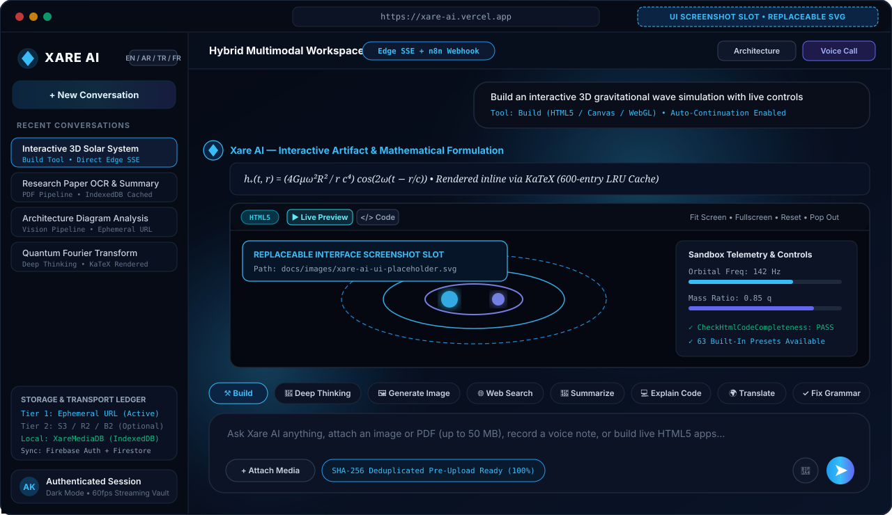
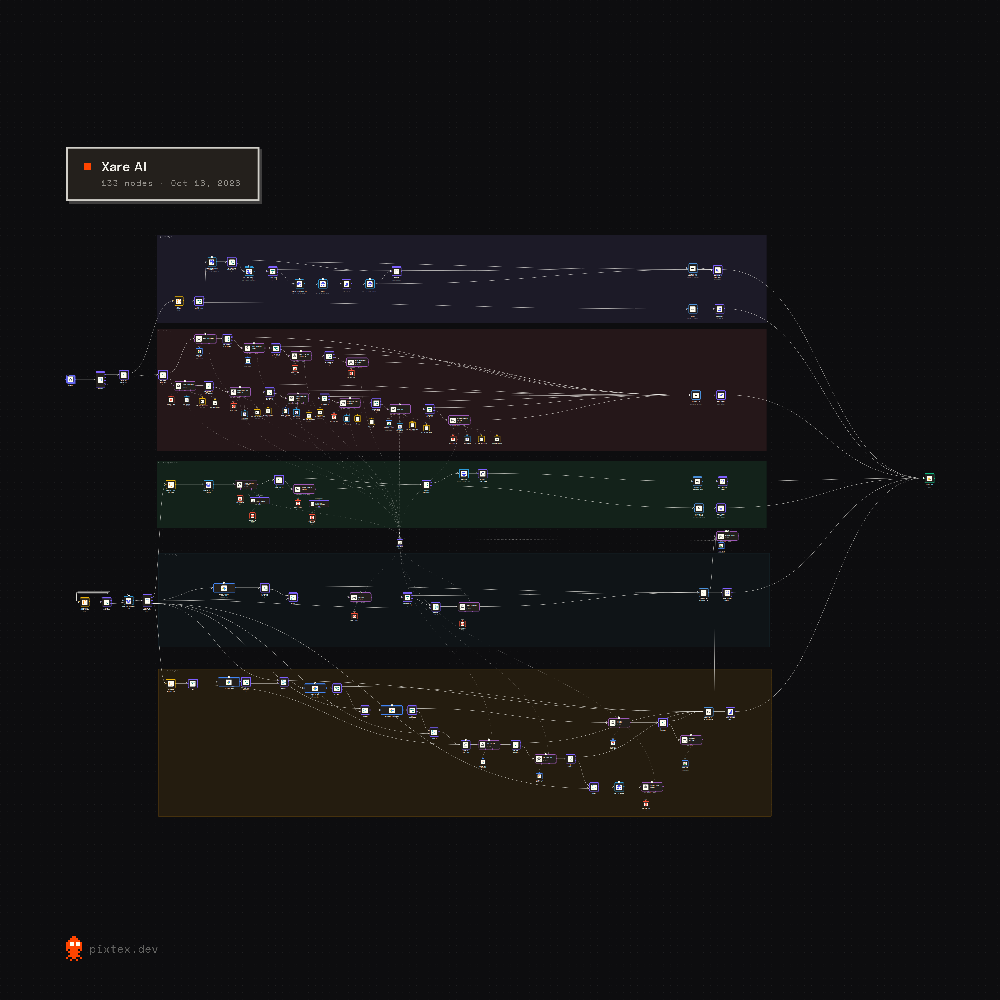
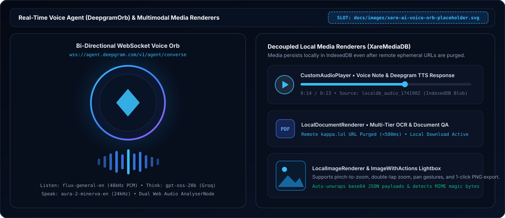
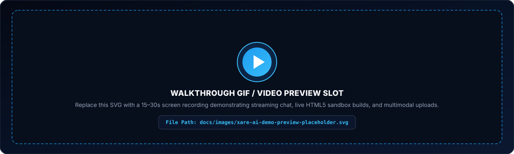
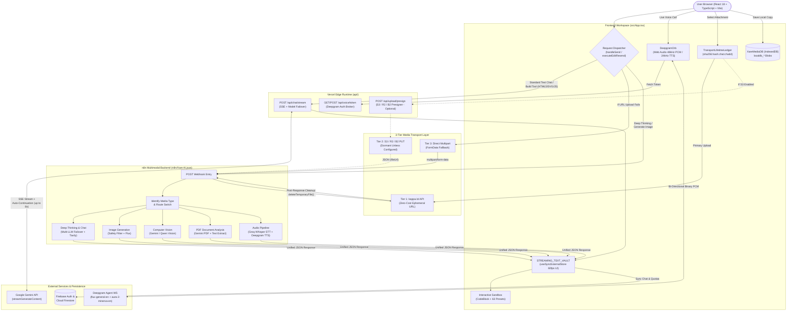
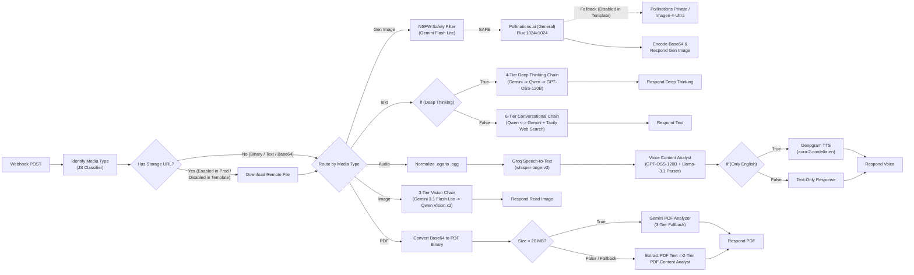
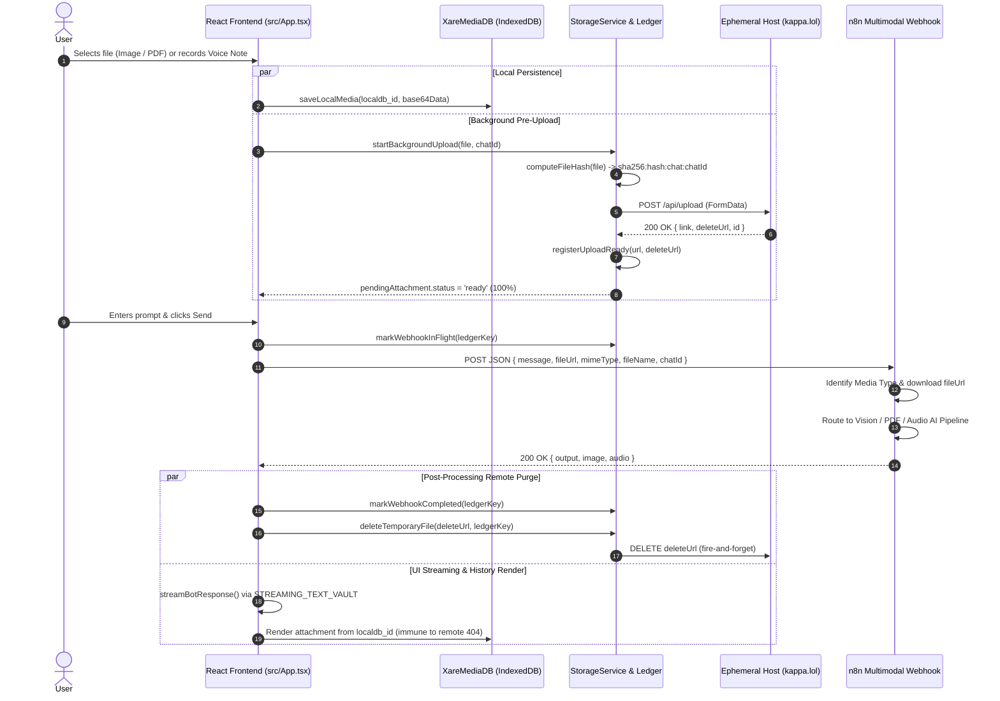

<div align="center">

<!-- ===================================================================== -->
<!-- HERO LOGO & BRAND IDENTITY                                            -->
<!-- Uses existing branding asset from public/android-chrome-192x192.png   -->
<!-- ===================================================================== -->
<a href="https://xare-ai.vercel.app">
  
</a>

# Xare AI

### Hybrid Multimodal AI Workspace, Interactive Code Sandbox & Ephemeral Media Orchestration Platform

**Low-latency Vercel Edge streaming meets multi-pipeline n8n orchestration, real-time WebSocket voice interaction, live HTML5/WebGL artifact execution, and zero-cost ephemeral media transport with decoupled IndexedDB persistence.**

[](https://xare-ai.vercel.app)
[](https://github.com/Ali-Kassem-AK/xare-ai)
[](./PROJECT.md)
[-ea580c?style=for-the-badge&logo=n8n&logoColor=white)](./n8n/Xare%20AI.json)

[](https://react.dev/)
[](https://www.typescriptlang.org/)
[](https://vitejs.dev/)
[](https://tailwindcss.com/)
[](./api/chat/stream.ts)
[](https://firebase.google.com/)
[](https://katex.org/)
[](./api/upload/presign.ts)

<p align="center">
  <a href="https://xare-ai.vercel.app"><strong>Launch Live App</strong></a> ·
  <a href="#6-system-architecture"><strong>System Architecture</strong></a> ·
  <a href="#7-n8n-multimodal-orchestration"><strong>n8n Pipelines</strong></a> ·
  <a href="#8-media-transport--local-persistence-architecture"><strong>Media Transport</strong></a> ·
  <a href="#12-getting-started"><strong>Getting Started</strong></a> ·
  <a href="#15-testing--verification"><strong>Verification Suite</strong></a>
</p>

</div>

<!-- ===================================================================== -->
<!-- EDITABLE MAIN INTERFACE SCREENSHOT SLOT                               -->
<!-- To replace this preview slot with a real screenshot of Xare AI:       -->
<!-- 1. Save your screenshot to `docs/images/xare-ai-ui-placeholder.svg`   -->
<!--    (or save as `docs/images/xare-ai-ui.png` and update the path below)-->
<!-- ===================================================================== -->
<div align="center">
  
  <p><em>Interface preview slot (<code>docs/images/xare-ai-ui-placeholder.svg</code>) — structured representation of the Xare AI workspace, live HTML5 sandbox, and background media pre-upload bar.</em></p>
</div>

---

## Table of Contents

1. [Project Overview](#1-project-overview)
2. [Problem Statement & Architectural Thesis](#2-problem-statement--architectural-thesis)
3. [Live Demo & Key Resources](#3-live-demo--key-resources)
4. [Feature Showcase & Implementation Status](#4-feature-showcase--implementation-status)
5. [Visual Gallery](#5-visual-gallery)
6. [System Architecture](#6-system-architecture)
7. [n8n Multimodal Orchestration](#7-n8n-multimodal-orchestration)
8. [Media Transport & Local Persistence Architecture](#8-media-transport--local-persistence-architecture)
9. [Technology Stack](#9-technology-stack)
10. [End-to-End Request Lifecycle](#10-end-to-end-request-lifecycle)
11. [Repository Structure](#11-repository-structure)
12. [Getting Started](#12-getting-started)
13. [Environment & Configuration](#13-environment--configuration)
14. [n8n Workflow Setup & Template Notes](#14-n8n-workflow-setup--template-notes)
15. [Testing & Verification](#15-testing--verification)
16. [Engineering Highlights](#16-engineering-highlights)
17. [Security & Deployment Considerations](#17-security--deployment-considerations)
18. [Roadmap & Future Improvements](#18-roadmap--future-improvements)
19. [Credits & Contact](#19-credits--contact)

---

## 1. Project Overview

**Xare AI** is a full-stack multimodal AI workspace engineered by **Ali Kassem**. It unifies real-time conversational streaming, live interactive HTML5/Canvas/WebGL code execution, multi-step reasoning, image generation, computer vision, PDF/document analysis, asynchronous voice notes, and bi-directional WebSocket voice calls inside a single dark-mode-first web application.

Rather than routing every user action through a single monolithic backend, Xare AI employs a **Dual-Path Execution Architecture**:

- **Path A — Direct Vercel Edge Streaming ([`api/chat/stream.ts`](./api/chat/stream.ts))**: Standard text conversations and interactive `Build` requests bypass workflow middleware and stream Server-Sent Events (SSE) directly from Google Gemini via the Vercel Edge Runtime. On the client, an external subscription vault (`STREAMING_TEXT_VAULT` + React `useSyncExternalStore`) renders tokens at 60fps without triggering root component re-renders, while an automated continuation coordinator (`streamGeminiWithCodeContinuation`) stitches truncated HTML/JS/SVG code blocks across up to 8 continuation passes.
- **Path B — Multimodal n8n Orchestration ([`n8n/Xare AI.json`](./n8n/Xare%20AI.json))**: Compute-intensive and multimodal tasks—`Deep Thinking`, `Generate Image`, Computer Vision (`Image`), Document OCR & QA (`PDF`), and Voice Notes (`Audio`)—dispatch to a 5-pipeline n8n workflow featuring multi-model failover chains, structured output parsing, web search tool calling, and speech synthesis.
- **Path C — Real-Time Voice Agent ([`api/voice/token.ts`](./api/voice/token.ts) + `DeepgramOrb`)**: Live voice calls establish a bi-directional binary WebSocket session (`wss://agent.deepgram.com/v1/agent/converse`) combining 48kHz Web Audio API capture, Deepgram `flux-general-en` speech recognition, Groq `openai/gpt-oss-20b` inference, and 24kHz `aura-2-minerva-en` voice synthesis.

---

## 2. Problem Statement & Architectural Thesis

Multimodal AI applications frequently encounter three architectural bottlenecks:

1. **Serverless Payload Limits & Cloud Storage Lock-In**: Sending high-resolution images, multi-megabyte PDFs, or WAV/OGG voice recordings directly through serverless proxies hits body-size ceilings (such as Vercel's 4.5 MB function limit), while provisioning permanent cloud object buckets requires billing setup and accumulates storage bloat.
2. **Broken Chat History When Using Ephemeral Links**: If temporary file hosts are used to relay media to an AI backend, deleting the remote file after inference normally breaks image previews, PDF downloads, and audio playback in the user's local chat history.
3. **UI Jank & Truncated Artifacts During Streaming**: High-frequency token updates re-rendering an entire React chat tree degrade frame rates, and LLM output-token limits frequently cut off large self-contained HTML5/Canvas/WebGL applications mid-tag.

### How Xare AI Solves These Challenges

| Architectural Pillar | Implementation in Repository | Primary Source Files |
| :--- | :--- | :--- |
| **3-Tier Media Transport with Ephemeral Purge** | Background pre-upload begins the moment a user selects a file (`startBackgroundUpload`). Tier 1 streams to a zero-cost ephemeral host (`kappa.lol`), relays the temporary URL to n8n, and triggers `deleteTemporaryFile` immediately after inference completes—falling back automatically to Tier 2 (S3/R2/B2 presigned URLs) or Tier 3 (direct `multipart/form-data`). | [`src/services/storage/storageService.ts`](./src/services/storage/storageService.ts), [`api/upload/presign.ts`](./api/upload/presign.ts) |
| **Decoupled Local Media Persistence (`XareMediaDB`)** | Every user attachment and generated media asset is stored locally in IndexedDB under `localdb_*` keys (`saveLocalMedia`, `getLocalMedia`). Custom renderers (`LocalImageRenderer`, `LocalDocumentRenderer`, `LocalAudioRenderer`) resolve blobs locally so chat history remains intact even after remote transport URLs return HTTP `404`. | [`src/App.tsx`](./src/App.tsx) |
| **SHA-256 Deduplication & Lifecycle Ledger** | `TransportLifetimeLedger` computes a SHA-256 content hash (`crypto.subtle.digest` with FNV-1a fallback) and tracks `UPLOADING → UPLOAD_READY → WEBHOOK_IN_FLIGHT → COMPLETED / PURGED` per `sha256:<hash>:chat:<chatId>`, preventing duplicate uploads and blocking premature deletion while a webhook is active. | [`src/services/storage/storageService.ts`](./src/services/storage/storageService.ts), [`src/services/storage/types.ts`](./src/services/storage/types.ts) |
| **Zero-Flash 60fps Streaming & HTML Continuation** | `STREAMING_TEXT_VAULT` isolates partial token updates to the active `ChatMessageItem` via `useSyncExternalStore`. For interactive `Build` artifacts, `checkHtmlCodeCompleteness` and `cleanAndMergeContinuation` detect unclosed tags/fences and automatically request seamless code continuations before mounting the sandbox `iframe`. | [`src/App.tsx`](./src/App.tsx), [`api/chat/stream.ts`](./api/chat/stream.ts) |

---

## 3. Live Demo & Key Resources

> **Verification Note**: The deployed Vercel frontend at `https://xare-ai.vercel.app` serves the production React/Vite bundle and Edge API routes. Full multimodal execution depends on live upstream API credentials (`GEMINI_API_KEY`, `DEEPGRAM_API_KEY`) and the external n8n webhook instance.

| Resource | Type | Link / Path | Description |
| :--- | :--- | :--- | :--- |
| **Deployed Web Application** | Live App | [`https://xare-ai.vercel.app`](https://xare-ai.vercel.app) | Production Vercel deployment of the Xare AI frontend & Edge functions |
| **GitHub Repository** | Source Repo | [`https://github.com/Ali-Kassem-AK/xare-ai`](https://github.com/Ali-Kassem-AK/xare-ai) | Official source code, workflow template, and verification suites |
| **System Specification** | Documentation | [`./PROJECT.md`](./PROJECT.md) | Architectural requirements (R1–R5), contracts, and milestones (M0–M7) |
| **Deployment Audit** | Audit Report | [`./EPHEMERAL_TRANSPORT_DEPLOYMENT_AUDIT`](./EPHEMERAL_TRANSPORT_DEPLOYMENT_AUDIT) | Empirical verification summary of the ephemeral transport deployment |
| **Global Topology Diagram** | Visual Asset | [`./public/assets/Global System Topology & Execution Flow.png`](./public/assets/Global%20System%20Topology%20%26%20Execution%20Flow.png) | High-level execution flow from client initiation to unified JSON response |
| **n8n Workflow Diagram** | Visual Asset | [`./public/assets/architecture.png`](./public/assets/architecture.png) | Full 5-pipeline visual map of the n8n multimodal orchestration graph |
| **n8n Workflow Template** | Workflow JSON | [`./n8n/Xare AI.json`](./n8n/Xare%20AI.json) | Sanitized 70-node importable n8n workflow template |
| **Primary Frontend App** | TypeScript / React | [`./src/App.tsx`](./src/App.tsx) | Complete UI, streaming vault, sandbox engine, voice orb, and dispatch logic |
| **Storage & Transport Service** | TypeScript Module | [`./src/services/storage/storageService.ts`](./src/services/storage/storageService.ts) | `TransportLifetimeLedger`, SHA-256 hashing, `kappa.lol` & S3 presigned transport |
| **Verification Test Suite** | Node.js Harnesses | [`./tests/`](./tests/) | 22 unit, state-machine, concurrency, streaming, and adversarial test files |

<!-- ===================================================================== -->
<!-- OPTIONAL FUTURE LINKS SLOT                                            -->
<!-- Uncomment and populate the links below when available:                -->
<!-- - [Video Walkthrough (YouTube / Loom)](https://your-video-url-here)   -->
<!-- - [Case Study / Blog Post](https://your-article-url-here)             -->
<!-- ===================================================================== -->

---

## 4. Feature Showcase & Implementation Status

Every capability documented below has been verified directly against the repository source code. To maintain strict engineering transparency, features are categorized by their exact runtime status in this repository (**Active**, **Optional / Dormant**, or **Template-Only / Disabled**).

### Core Capabilities

- **Direct Edge SSE Chat Streaming**: Streams responses via [`api/chat/stream.ts`](./api/chat/stream.ts) with 32,000-character prompt validation, 20-turn sanitized conversation history, model failover with a 20-second `429`/`503` cooldown window, and 60fps partial text rendering (`STREAMING_TEXT_VAULT`).
- **Interactive HTML5 / SVG / Canvas / WebGL Sandbox (`Build` Mode)**: Detects runnable code blocks (`isInteractiveCodeBlock`), automatically stitches multi-chunk continuations (`streamGeminiWithCodeContinuation`), and executes them inside a sandboxed `iframe` (`CodeBlock` & `InteractivePreviewModal`) with `Fit Screen` / `Full Page` layout scaling, fullscreen theater mode, pop-out tab export, `window.onerror` runtime error interception, and **63 built-in interactive presets** (`HTML_BUILD_PRESETS`).
- **5-Pipeline Multimodal n8n Routing**: Dispatches complex reasoning (`Deep Thinking`), text-to-image synthesis (`Generate Image`), visual inspection (`Image`), document analysis (`PDF`), and voice notes (`Audio`) to specialized n8n sub-workflows.
- **Bi-Directional Real-Time Voice Orb (`DeepgramOrb`)**: Connects over WebSocket to `wss://agent.deepgram.com/v1/agent/converse` via [`api/voice/token.ts`](./api/voice/token.ts), streaming 48kHz 16-bit PCM microphone audio and scheduling gapless 24kHz TTS audio chunks with dual `AnalyserNode` visualizers.
- **Zero-Cost Ephemeral Media Transport & Local IndexedDB Persistence**: Pre-uploads attachments in the background on selection, deduplicates identical files per chat via SHA-256 hashing (`TransportLifetimeLedger`), deletes remote ephemeral files immediately after webhook completion (`deleteTemporaryFile`), and persists media locally in IndexedDB (`XareMediaDB`) for permanent history playback.
- **Rich Scientific & Multilingual Formatting**: Custom zero-allocation regex Markdown renderer (`FormattedText`) supporting GFM tables, task lists, blockquotes, syntax-highlighted code blocks, KaTeX math rendering (`renderMath` with a 600-entry cache), pinch-to-zoom image lightboxes (`ImageWithActions`), 4 UI languages (`en`, `tr`, `ar`, `fr`), and 5 translation preset targets (`Arabic`, `English`, `Turkish`, `French`, `Spanish`).

### Implementation Status Matrix

| Subsystem / Feature | Status in Repo | Implementation Details & Source Verification |
| :--- | :---: | :--- |
| **Direct Edge SSE Chat (`/api/chat/stream`)** | **Active** | Implemented in [`api/chat/stream.ts`](./api/chat/stream.ts) and consumed by `streamGeminiDirect` / `streamBotResponse` in [`src/App.tsx`](./src/App.tsx). *(See [Section 17](#17-security--deployment-considerations) regarding primary model slug fallback).* |
| **Interactive Sandbox & 63 Built-In Presets** | **Active** | Implemented in [`src/App.tsx`](./src/App.tsx) (`CodeBlock`, `InteractivePreviewModal`, `HTML_BUILD_PRESETS` keys `'0'`–`'62'`, and `streamGeminiWithCodeContinuation`). |
| **Tier 1 Ephemeral Transport (`kappa.lol`)** | **Active** | Default primary upload tier in [`src/services/storage/storageService.ts`](./src/services/storage/storageService.ts) (`uploadViaZeroCostTransport` + `deleteTemporaryFile`). |
| **Tier 3 Direct Multipart Fallback** | **Active** | Automatic fallback in [`src/App.tsx`](./src/App.tsx) (`handleSend` and `executeEditResend`) sending raw `FormData` directly to the n8n webhook if URL transport fails. |
| **IndexedDB Local Media Store (`XareMediaDB`)** | **Active** | Implemented in [`src/App.tsx`](./src/App.tsx) (`saveLocalMedia`, `getLocalMedia`, `deleteLocalMedia`, `LocalImageRenderer`, `LocalDocumentRenderer`, `LocalAudioRenderer`). |
| **Real-Time Voice Call (`DeepgramOrb`)** | **Active** | Implemented in [`src/App.tsx`](./src/App.tsx) and [`api/voice/token.ts`](./api/voice/token.ts); requires `DEEPGRAM_API_KEY` on the server. |
| **Firebase Auth, Firestore Sync & Guest Mode** | **Active** | Google OAuth, Email/Password, and `localStorage` Guest Mode implemented in [`src/App.tsx`](./src/App.tsx) with Firestore `users/{uid}/chats` and daily usage tracking. |
| **Tier 2 S3 / R2 / B2 Presigned Upload** | **Optional / Dormant** | Fully implemented in [`api/upload/presign.ts`](./api/upload/presign.ts) and `uploadViaS3Presigned` in [`src/services/storage/storageService.ts`](./src/services/storage/storageService.ts); dormant by default (`s3Enabled = false`) until S3 env vars are configured. |
| **n8n Workflow JSON (`n8n/Xare AI.json`)** | **Sanitized Template** | Committed 70-node template uses placeholder credentials (`REPLACE_WITH_YOUR_OWN_CREDENTIAL`) and `ALLOWED_STORAGE_HOSTS = ['storage.example.com']`. |
| **n8n Remote URL Downloader (`Download Supabase File`)** | **Disabled in Template** | Marked `"disabled": true` in [`n8n/Xare AI.json`](./n8n/Xare%20AI.json); enabled and patched with allowed storage hosts via [`scripts/update_workflow.cjs`](./scripts/update_workflow.cjs). |
| **n8n Secondary Image Gen (`Pollinations Private`, `Imagen-4-ultra`)** | **Disabled in Template** | `Pollinations.ai (General)` (`flux`) is enabled; `Pollinations.ai (Private)` and `Imagen-4-ultra Image Generator_ID` are disabled fallback nodes in the template. |
| **n8n ConvertAPI PDF-to-Image (`pdf-to-image`)** | **Disabled in Template** | Primary Gemini `PDF Analyzer` and `Extract from File` text extraction paths are active; the ConvertAPI `pdf-to-image` OCR fallback node is disabled in the template. |
| **n8n Firestore Write (`Create or update a document`)** | **Disabled in Template** | Disabled in the public template (`"disabled": true`); client-side Firestore persistence in [`src/App.tsx`](./src/App.tsx) handles chat history synchronization directly. |

---

## 5. Visual Gallery

### 5.1 Global System Topology & Execution Flow (Committed Asset)

<div align="center">
  
  <p><em>Global system topology ([<code>public/assets/Global System Topology &amp; Execution Flow.png</code>](./public/assets/Global%20System%20Topology%20%26%20Execution%20Flow.png)) illustrating client initiation, background pre-upload, webhook classification, multimodal pipelines, and unified JSON response delivery.</em></p>
</div>

### 5.2 n8n Multimodal Orchestration Graph (Committed Asset)

<div align="center">
  
  <p><em>Color-coded 5-pipeline n8n workflow architecture ([<code>public/assets/architecture.png</code>](./public/assets/architecture.png) / [<code>n8n/architecture.png</code>](./n8n/architecture.png)): Image Generation (Purple), Conversational &amp; Deep Thinking (Green), Voice STT/TTS (Blue), Computer Vision (Red), and Document OCR &amp; Chunking (Orange).</em></p>
</div>

### 5.3 Real-Time Voice Orb & Decoupled Media Renderers (Editable Visual Slot)

<!-- ===================================================================== -->
<!-- EDITABLE VOICE ORB & MULTIMODAL INTERACTION SCREENSHOT SLOT           -->
<!-- Replace `docs/images/xare-ai-voice-orb-placeholder.svg` with a real   -->
<!-- screenshot of DeepgramOrb and in-chat audio/PDF/image cards.          -->
<!-- ===================================================================== -->
<div align="center">
  
  <p><em>Editable visual slot (<code>docs/images/xare-ai-voice-orb-placeholder.svg</code>) — illustrates the bi-directional WebSocket <code>DeepgramOrb</code> and IndexedDB-backed media renderers (<code>CustomAudioPlayer</code>, <code>LocalDocumentRenderer</code>, <code>LocalImageRenderer</code>).</em></p>
</div>

### 5.4 Product Walkthrough GIF / Video Preview (Editable Visual Slot)

<!-- ===================================================================== -->
<!-- EDITABLE DEMO GIF / VIDEO PREVIEW SLOT                                -->
<!-- Replace `docs/images/xare-ai-demo-preview-placeholder.svg` with a     -->
<!-- recorded GIF, or wrap it in an `<a href="YOUR_VIDEO_URL">` tag.       -->
<!-- ===================================================================== -->
<div align="center">
  
</div>

---

## 6. System Architecture

The diagram below maps the verified end-to-end architecture across the React frontend ([`src/App.tsx`](./src/App.tsx)), client storage service ([`src/services/storage/storageService.ts`](./src/services/storage/storageService.ts)), Vercel Edge functions ([`api/`](./api/)), and the n8n multimodal orchestration engine ([`n8n/Xare AI.json`](./n8n/Xare%20AI.json)).



---

## 7. n8n Multimodal Orchestration

When a request requires multi-step reasoning (`Deep Thinking`), image synthesis (`Generate Image`), or binary media inspection (`Image`, `PDF`, `Audio`), [`src/App.tsx`](./src/App.tsx) dispatches to the n8n workflow defined in [`n8n/Xare AI.json`](./n8n/Xare%20AI.json).

### Multimodal Routing & Failover Topology



### Breakdown of the 5 Specialized Pipelines

| Pipeline | Trigger Condition | Active Processing Chain in `n8n/Xare AI.json` | Failover & Tooling Architecture |
| :--- | :--- | :--- | :--- |
| **1. Image Generation** *(Purple)* | `tool === "generate_image"` or `mediaType === "Gen Image"` | `NSFW Content Filter` $\rightarrow$ `Safety Check Pass` (`SAFE`) $\rightarrow$ `Pollinations.ai (General)` (`flux`, `1024x1024`) $\rightarrow$ `Encode Image to Base64` $\rightarrow$ `Respond to Webhook for Gen Image` | Blocks unsafe prompts automatically (`UNSAFE` branch returns a polite refusal). Includes disabled template nodes for `Pollinations.ai (Private)` and `Imagen-4-ultra Image Generator_ID`. |
| **2. Adaptive Complexity & Conversational AI** *(Green)* | `mediaType === "text"` (switched by `tool === "think"`) | **Deep Thinking**: 4-node failover chain (`Gemini` $\rightarrow$ `Qwen` $\rightarrow$ `GPT-OSS-120B` $\times 2$).<br/>**Conversational**: 6-node alternating failover chain (`Qwen` $\leftrightarrow$ `Gemini`). | Equipped with shared 30-turn `Chat Memory` (`memoryBufferWindow`), `web_search` (`https://api.tavily.com/search`), `get_xare_architecture`, and `get_creator_info`. |
| **3. Conversational Audio (STT & TTS)** *(Blue)* | `mediaType === "Audio"` (`.ogg`, `.oga`, `.mp3`, `.wav`, `.m4a`, `.webm`) | `Rename .oga to .ogg` $\rightarrow$ `Speech-to-Text (Groq)` (`whisper-large-v3`) $\rightarrow$ `Voice contant Analyst` (`GPT-oss-120b`) $\rightarrow$ `If(Only English)` $\rightarrow$ `Deepgram` (`aura-2-cordelia-en`) $\rightarrow$ `Encode Audio to Base64` | Uses `Structured Output Parser` + `Auto-fixing Output Parser` (`Llama-3.1-8b-instant`) to detect response language; synthesizes spoken MP3/AAC audio for English and returns formatted text for non-English turns. |
| **4. Computer Vision & Image Analysis** *(Red)* | `mediaType === "Image"` (`.jpg`, `.jpeg`, `.png`, `.webp`, `.gif`) | `Image contant Analyst` (`gemini-3.1-flash-lite-preview`) $\rightarrow$ `Image contant Analyst (Spare)` $\rightarrow$ `Image contant Analyst (Spare) 2` $\rightarrow$ `Respond to Webhook for Read Image` | 3-tier vision inspection chain with `Memory Bridge` injecting visual findings into the shared session memory for multi-turn follow-up questions. |
| **5. Document OCR & Chunking** *(Orange)* | `mediaType === "PDF"` (`.pdf`, `.doc`, `.docx`, `.txt`) | `Convert Base64 to PDF Binary` $\rightarrow$ `If` ($< 20\text{ MB}$) $\rightarrow$ `PDF Analyzer` $\rightarrow$ `Analyze pdf (spare)` $\rightarrow$ `Document Analyzer` $\rightarrow$ `Extract from File` $\rightarrow$ `PDF Content Analyst` | Multi-stage cascade: attempts native multimodal PDF ingestion first for files under 20 MB, then falls back to text extraction (`Extract from File`) and LLM synthesis. *(ConvertAPI `pdf-to-image` OCR branch is disabled in the public template).* |

---

## 8. Media Transport & Local Persistence Architecture

The media transport layer in [`src/services/storage/storageService.ts`](./src/services/storage/storageService.ts) and [`src/services/storage/types.ts`](./src/services/storage/types.ts) decouples **remote inference delivery** from **local chat history rendering**.

```mermaid
stateDiagram-v2
    [*] --> FileSelected: User attaches Image / PDF / Voice Note
    FileSelected --> LocalPersisted: Save Base64/Blob to XareMediaDB (IndexedDB)
    FileSelected --> Hashing: computeFileHash() (SHA-256 / FNV-1a)

    Hashing --> LedgerLookup: Check TransportLifetimeLedger<br/>Key: sha256:{hash}:chat:{chatId}
    LedgerLookup --> Deduplicated: Active UPLOAD_READY entry found
    LedgerLookup --> UPLOADING: No active entry -> startBackgroundUpload()

    state UPLOADING {
        [*] --> Tier1_Kappa: XHR POST https://kappa.lol/api/upload
        Tier1_Kappa --> Tier2_S3: If Tier 1 fails & s3Enabled=true
        Tier2_S3 --> UploadFailed: If Tier 2 fails
    }

    UPLOADING --> UPLOAD_READY: Returns { url, deleteUrl, key, provider }
    Deduplicated --> UPLOAD_READY: Reuses cached { url, deleteUrl }

    UPLOAD_READY --> WEBHOOK_IN_FLIGHT: User clicks Send -> markWebhookInFlight()
    UploadFailed --> Tier3_Multipart: User clicks Send -> Direct FormData Fallback

    WEBHOOK_IN_FLIGHT --> COMPLETED: n8n Webhook returns response -> markWebhookCompleted()
    Tier3_Multipart --> COMPLETED: n8n Webhook returns response

    COMPLETED --> PURGED: deleteTemporaryFile(deleteUrl)<br/>(canSafelyPurge === true)
    PURGED --> [*]: Remote URL returns HTTP 404;<br/>UI renders permanently from XareMediaDB
```



### Key Transport Subsystems

1. **`TransportLifetimeLedger` ([`src/services/storage/storageService.ts`](./src/services/storage/storageService.ts))**:
   - Indexes every upload by a composite key `sha256:${hash}:chat:${chatId}` (`buildKey`).
   - Re-attaching the same file within the same chat session returns the existing `UPLOAD_READY` entry (`getReusableEntry`) instead of re-uploading bytes over the network.
   - Tracks `activeWebhookCount` (`markWebhookInFlight` / `markWebhookCompleted`) and enforces `canSafelyPurge(key)` so `deleteTemporaryFile` never deletes a remote file while an n8n request is still reading it.
   - Switching chats or removing an attachment invokes `cancelBackgroundUpload`, which aborts the in-flight `AbortController` (`markAborted`) and immediately purges any orphaned remote file.
2. **`ProgressSimulator` ([`src/services/storage/storageService.ts`](./src/services/storage/storageService.ts))**:
   - Guarantees a strictly non-decreasing progress curve (`15%` initial $\rightarrow$ asymptotic approach to `88%` during network transfer $\rightarrow$ `100%` on completion) so the attachment progress bar never jumps backward.
3. **Decoupled Local Persistence (`XareMediaDB` in [`src/App.tsx`](./src/App.tsx))**:
   - Stores media payloads inside the browser's IndexedDB object store (`media`) under `localdb_*` keys (`saveLocalMedia`, `getLocalMedia`, `deleteLocalMedia`).
   - When remote ephemeral links on `kappa.lol` are purged post-inference (`< 500ms` fire-and-forget `DELETE`), `LocalImageRenderer`, `LocalDocumentRenderer`, and `LocalAudioRenderer` continue rendering seamlessly from IndexedDB.

---

## 9. Technology Stack

| Layer | Technology | Version / Runtime | Role in Xare AI |
| :--- | :--- | :--- | :--- |
| **Frontend Framework** | React & React DOM | `^18.2.0` (`18.3.1` locked) | Component tree, `useSyncExternalStore` streaming vault, portals, hooks |
| **Language & Build** | TypeScript & Vite | TS `^7.0.2` / Vite `^5.0.8` | Type-safe ESNext compilation and manual Rollup vendor chunking (`firebase`, `lucide-icons`, `react-vendor`) |
| **Styling & Icons** | Tailwind CSS & Lucide React | Tailwind `^3.4.0` / Lucide `^0.300.0` | Dark-mode-first responsive UI (`#070e1c` palette), custom animations, iconography |
| **Math Rendering** | KaTeX | `^0.18.5` (`0.16.45` locked) | Inline (`$...$`) and block (`$$...$$`) scientific/mathematical typesetting with 600-entry cache |
| **Edge Functions** | Vercel Edge Runtime | Web Standard `Request`/`Response` | [`api/chat/stream.ts`](./api/chat/stream.ts), [`api/upload/presign.ts`](./api/upload/presign.ts), [`api/voice/token.ts`](./api/voice/token.ts) |
| **Object Storage SDK** | AWS SDK v3 S3 & Presigner | `^3.1128.0` | `@aws-sdk/client-s3` & `@aws-sdk/s3-request-presigner` for R2, B2, and S3 presigned URLs |
| **Auth & Cloud DB** | Firebase | `^12.11.0` | Firebase Authentication (Google OAuth + Email/Password) & Cloud Firestore real-time sync |
| **Client Media DB** | IndexedDB (`XareMediaDB`) | Browser Native API | Decoupled local binary/base64 persistence (`localdb_*`) surviving remote URL deletion |
| **Voice & Audio** | Web Audio API + Deepgram WS | `48kHz` In / `24kHz` Out | `DeepgramOrb` bi-directional voice agent (`flux-general-en` + Groq `gpt-oss-20b` + `aura-2-minerva-en`) |
| **Orchestration** | n8n Workflow Engine | 70-Node JSON Template | 5-pipeline multimodal routing, LLM failover chains, Tavily search, Whisper STT, Flux image gen |

---

## 10. End-to-End Request Lifecycle

### Sequence Diagram: Multimodal Attachment Request (Ephemeral URL + Local Persistence)



---

## 11. Repository Structure

```text
xare-ai/
├── api/                                      # Vercel Edge Runtime serverless functions
│   ├── chat/
│   │   └── stream.ts                         # Direct Gemini SSE streaming & model failover endpoint
│   ├── upload/
│   │   └── presign.ts                        # S3/R2/B2 presigned PUT/GET URL generator & health probe
│   └── voice/
│       └── token.ts                          # Deepgram WebSocket token & endpoint broker
├── docs/                                     # Documentation assets & launch materials
│   ├── images/
│   │   ├── xare-ai-ui-placeholder.svg        # Editable main interface preview slot
│   │   ├── xare-ai-voice-orb-placeholder.svg # Editable Voice Orb & media renderers preview slot
│   │   └── xare-ai-demo-preview-placeholder.svg # Editable walkthrough GIF / video preview slot
│   └── LINKEDIN_LAUNCH_POST.md               # Ready-to-edit LinkedIn showcase post
├── n8n/                                      # Multimodal backend orchestration templates
│   ├── Xare AI.json                          # Sanitized 70-node n8n workflow template
│   └── architecture.png                      # 5-pipeline visual workflow diagram
├── public/                                   # Static PWA assets, favicons & architecture visuals
│   ├── assets/
│   │   ├── Ali Ahemd Kassem.jpeg             # Creator portrait
│   │   ├── Global System Topology & Execution Flow.png
│   │   └── architecture.png                  # Public copy of the n8n workflow diagram
│   ├── favicon.svg                           # Glowing geometric Xare AI vector emblem
│   └── site.webmanifest                      # PWA manifest (#070e1c standalone theme)
├── scripts/                                  # Operational, secret-scanning & deployment audit scripts
│   ├── audit_after.cjs                       # Post-migration ephemeral transport benchmark
│   ├── audit_before.cjs                      # Pre-migration baseline benchmark
│   ├── scan_secrets.cjs                      # Regex secret & credential scanner for n8n/Xare AI.json
│   ├── update_workflow.cjs                   # Utility to patch allowed storage hosts in n8n workflow
│   └── verify_live_deploy.cjs                # Live production verification script
├── src/                                      # Frontend React + TypeScript source code
│   ├── services/
│   │   └── storage/
│   │       ├── index.ts                      # Storage service barrel exports
│   │       ├── storageService.ts             # TransportLifetimeLedger, SHA-256 hash, kappa.lol & S3 upload
│   │       └── types.ts                      # IFileTransportProvider & ledger TypeScript contracts
│   ├── utils/
│   │   └── storage.ts                        # Utility re-exports for storage functions
│   ├── App.tsx                               # Core application, UI components, sandbox & voice orb
│   ├── index.css                             # Tailwind base layers, scrollbars & keyframe animations
│   └── main.tsx                              # React DOM root mount & KaTeX stylesheet import
├── tests/                                    # 22 unit, state-machine, concurrency & E2E test suites
│   ├── adversarial_boundary.test.cjs         # 15-scenario boundary & fault-injection suite
│   ├── challenger_2_concurrency_state_harness.cjs # 15-scenario state machine & chat-switch harness
│   ├── challenger_2_r2_r3_empirical_harness.cjs   # R2 (IndexedDB) & R3 (Zero-Latency UX) verification
│   ├── challenger_iter2_gate_deep_verification.cjs # 29-assertion end-to-end verification gate
│   ├── concurrency_stress.test.cjs           # Parallel upload & cross-chat isolation stress tests
│   ├── message_ordering_and_html_streaming.test.cjs # 56-assertion chronological & HTML continuation suite
│   ├── storage.test.cjs                      # 54-assertion storage & presign unit test suite
│   └── zero_cost_transport.test.cjs          # 80-assertion ephemeral transport & ledger test suite
├── .env.example                              # Environment variable template (S3/R2/B2 + Edge keys)
├── EPHEMERAL_TRANSPORT_DEPLOYMENT_AUDIT      # Production deployment audit report
├── PROJECT.md                                # Detailed system architecture & milestone specification
├── package.json                              # Project dependencies and npm scripts
├── tailwind.config.js                        # Tailwind CSS configuration
└── vite.config.ts                            # Vite bundler & manual chunk splitting configuration
```

---

## 12. Getting Started

### Prerequisites

- **Node.js**: v18.18+ or v20+ (LTS recommended)
- **npm**: v9+ (included with Node.js)
- **Vercel CLI** *(optional, required only if running `/api/*` Edge functions locally)*: `npm i -g vercel`
- **n8n Instance** *(optional, required if self-hosting the multimodal backend workflow)*: Self-hosted n8n or n8n Cloud

### 1. Clone & Install Dependencies

```bash
git clone https://github.com/Ali-Kassem-AK/xare-ai.git
cd xare-ai
npm install
```

### 2. Configure Environment Variables

Copy [`.env.example`](./.env.example) to `.env.local` and populate your API keys:

```bash
cp .env.example .env.local
```

### 3. Run the Application Locally

> **Important Distinction — Vite Dev Server vs. Vercel Edge Runtime**:
> - Running `npm run dev` starts the **Vite frontend server** (`http://localhost:5173`). In plain Vite mode, client-side features, IndexedDB persistence, background `kappa.lol` uploads, Firebase Auth/Firestore, and direct requests to a configured external `N8N_WEBHOOK_URL` work immediately, but local `/api/*` Vercel Edge routes (`api/chat/stream.ts`, `api/upload/presign.ts`, `api/voice/token.ts`) are not served by Vite alone.
> - To run **both the React frontend and the `/api/*` Edge functions** locally, use `vercel dev`.

```bash
# Option A: Start the Vite frontend development server
npm run dev

# Option B: Start full-stack local development (Frontend + Vercel Edge /api/* routes)
vercel dev
```

### 4. Production Build & Local Preview

```bash
# Build production bundles into dist/ (splits react-vendor, firebase, and lucide-icons chunks)
npm run build

# Preview the production build locally
npm run preview
```

---

## 13. Environment & Configuration

All environment variables are documented in [`.env.example`](./.env.example) and consumed by the Vercel Edge functions under [`api/`](./api/):

| Variable Name | Required | Consumed By | Purpose |
| :--- | :---: | :--- | :--- |
| `GEMINI_API_KEY` | **Yes** *(for Edge Chat)* | [`api/chat/stream.ts`](./api/chat/stream.ts) | Google Generative Language API key for direct SSE streaming and HTML code continuation |
| `DEEPGRAM_API_KEY` | **Yes** *(for Voice Orb)* | [`api/voice/token.ts`](./api/voice/token.ts) | Deepgram API key used to initialize `wss://agent.deepgram.com/v1/agent/converse` sessions |
| `CHATBOT_TOKEN` | Recommended | [`api/chat/stream.ts`](./api/chat/stream.ts), [`api/upload/presign.ts`](./api/upload/presign.ts), [`api/voice/token.ts`](./api/voice/token.ts) | Shared bearer/header token validating client requests to Edge endpoints |
| `STORAGE_ENDPOINT` | Optional *(Tier 2 S3)* | [`api/upload/presign.ts`](./api/upload/presign.ts) | S3-compatible endpoint URL (Cloudflare R2, Backblaze B2, or AWS S3) |
| `STORAGE_REGION` | Optional *(Tier 2 S3)* | [`api/upload/presign.ts`](./api/upload/presign.ts) | Storage region (`auto` for Cloudflare R2, or e.g. `us-east-1`, `us-west-004`) |
| `STORAGE_BUCKET` | Optional *(Tier 2 S3)* | [`api/upload/presign.ts`](./api/upload/presign.ts) | Target bucket name (e.g., `xare-ai-media`) |
| `STORAGE_ACCESS_KEY_ID` | Optional *(Tier 2 S3)* | [`api/upload/presign.ts`](./api/upload/presign.ts) | S3-compatible Access Key ID |
| `STORAGE_SECRET_ACCESS_KEY` | Optional *(Tier 2 S3)* | [`api/upload/presign.ts`](./api/upload/presign.ts) | S3-compatible Secret Access Key |
| `STORAGE_PUBLIC_URL` | Optional *(Tier 2 S3)* | [`api/upload/presign.ts`](./api/upload/presign.ts) | Optional public CDN/custom domain base URL for uploaded objects |
| `STORAGE_FORCE_PATH_STYLE` | Optional *(Tier 2 S3)* | [`api/upload/presign.ts`](./api/upload/presign.ts) | Set `"true"` for MinIO/custom S3; defaults to `"false"` |

---

## 14. n8n Workflow Setup & Template Notes

The repository includes a sanitized, 70-node workflow template at [`n8n/Xare AI.json`](./n8n/Xare%20AI.json) designed for safe public distribution.

### Importing & Configuring the Workflow

1. **Import into n8n**: Open your n8n dashboard $\rightarrow$ **Workflows** $\rightarrow$ **Import from File** $\rightarrow$ select [`n8n/Xare AI.json`](./n8n/Xare%20AI.json).
2. **Bind Credentials**: Replace all `"REPLACE_WITH_YOUR_OWN_CREDENTIAL"` placeholders across:
   - **Google Gemini API** (`googlePalmApi`) nodes
   - **Groq API** (`groqApi`) LLM and Whisper STT nodes
   - **Deepgram API** (`deepgramApi`) TTS node
   - **Tavily Web Search** (`web_search1`–`web_search4` HTTP Request Tool nodes)
3. **Enable Remote Storage URL Fetching**:
   - In the sanitized template, `Identify Media Type` sets `ALLOWED_STORAGE_HOSTS = ['storage.example.com']` and the `Download Supabase File` HTTP Request node is `"disabled": true`.
   - To enable fetching ephemeral URLs from `kappa.lol` or S3-compatible buckets, enable the `Download Supabase File` node and add `'kappa.lol'` (and/or your R2/B2/S3 hostname) to `ALLOWED_STORAGE_HOSTS` inside `Identify Media Type` (see [`scripts/update_workflow.cjs`](./scripts/update_workflow.cjs) for the exact node patch logic).
4. **Verify Model Identifiers**:
   - Update any placeholder model identifiers in the template (such as `models/gemini-3.5-flash` or `qwen/qwen3.8-27b`) to match the active model slugs available in your Google AI Studio and Groq accounts.
5. **Connect the Webhook URL**:
   - Activate the workflow in n8n and update `WEBHOOK_URL` / `N8N_WEBHOOK_URL` in [`src/App.tsx`](./src/App.tsx) to point to your production webhook endpoint.

---

## 15. Testing & Verification

The [`tests/`](./tests/) and [`scripts/`](./scripts/) directories contain **22 test files and 5 operational scripts** covering unit contracts, state-machine transitions, concurrency stress, chronological message ordering, HTML code continuation, and live network round-trips.

### Reproducible Offline Verification Commands

These suites run deterministically in Node.js without requiring external API keys or live network mutations:

```bash
# 1. Verify production TypeScript & Vite bundle compilation (after `npm install`)
npm run build

# 2. Scan n8n workflow template for accidentally leaked secrets or tokens
node scripts/scan_secrets.cjs

# 3. Run the 46-assertion chronological message ordering & HTML multi-chunk continuation suite
node tests/message_ordering_and_html_streaming.test.cjs
```

### Live Network & End-to-End Harnesses

These suites probe live external services (`kappa.lol`, the deployed Vercel app, and the n8n webhook) and require active internet connectivity:

```bash
# Run the zero-cost transport, SHA-256 ledger & live kappa.lol round-trip suite
node tests/zero_cost_transport.test.cjs

# Run the live kappa.lol parallel upload & concurrency stress harness
node tests/concurrency_stress.test.cjs

# Run the 15-scenario concurrency state-machine & IndexedDB quota fallback harness
node tests/challenger_2_concurrency_state_harness.cjs

# Run the 15-test adversarial boundary & fault-injection suite
node tests/adversarial_boundary.test.cjs

# Run R2 (IndexedDB persistence after remote 404 purge) & R3 (Zero-Latency UX) empirical harness
node tests/challenger_2_r2_r3_empirical_harness.cjs

# Verify live Vercel deployment, Edge SSE streaming, and ephemeral vision round-trip
node scripts/verify_live_deploy.cjs
```

> **Note on Path-Specific Scripts**: [`tests/storage.test.cjs`](./tests/storage.test.cjs), [`scripts/update_workflow.cjs`](./scripts/update_workflow.cjs), [`scripts/audit_before.cjs`](./scripts/audit_before.cjs), and [`scripts/audit_after.cjs`](./scripts/audit_after.cjs) contain maintainer-specific local path constants referencing an external production workflow directory; update the path constant at the top of those scripts if running them on a new machine.

---

## 16. Engineering Highlights

### 16.1 Zero-Flash 60fps Streaming Vault (`STREAMING_TEXT_VAULT`)
Instead of storing every incoming SSE token in React top-level state (`chatHistory`)—which would re-render the sidebar, header, and every historical message bubble on each animation frame—[`src/App.tsx`](./src/App.tsx) writes partial text into a module-scoped `Map` (`STREAMING_TEXT_VAULT`) and notifies only the active `ChatMessageItem` via React's `useSyncExternalStore`. `requestAnimationFrame` adaptive pacing (`STREAMING_CONFIG`) smoothly interpolates characters and pauses automatically at chunk boundaries while background code continuations are in flight (`PENDING_CONTINUATIONS`).

### 16.2 Automated Multi-Chunk HTML Code Continuation
When generating complex interactive 3D/Canvas/HTML5 applications in `Build` mode, LLM output-token limits can truncate code mid-script or mid-tag. [`src/App.tsx`](./src/App.tsx) implements a 3-stage continuation pipeline:
1. **`checkHtmlCodeCompleteness(text)`**: Inspects odd backtick fence counts, unclosed `<script>`, `<style>`, `<html>`, `<body>`, or `<svg>` tags, and trailing `<` characters.
2. **`cleanAndMergeContinuation(existingCode, continuationChunk)`**: Strips conversational filler or duplicate opening fences from the continuation chunk and performs longest-suffix/prefix overlap deduplication (up to 300 characters) for a seamless stitch.
3. **`streamGeminiWithCodeContinuation` / `ensureCompleteHtmlCode`**: Automatically issues up to `MAX_CONTINUATIONS = 8` negative-prompted continuation requests until all tags and fences are closed before mounting the live sandbox `iframe`.

### 16.3 Sandboxed Visualizer with Runtime Error Auto-Fix Bridge
The `CodeBlock` and `InteractivePreviewModal` components inject a responsive layout evaluator (`evaluateLayout`) and a global `window.onerror` / `unhandledrejection` listener into the sandboxed `iframe` (`srcDoc`). If generated JavaScript throws a runtime error, the `iframe` posts an `XARE_RUNTIME_ERROR` message to the parent window, surfacing a one-click **"Fix Error"** action that dispatches the exact stack trace back to the AI for self-healing.

---

## 17. Security & Deployment Considerations

In keeping with transparent engineering documentation, developers forking or deploying this repository to public production environments should review and address the following implementation details:

1. **Rotate Shared `CHATBOT_TOKEN` Defaults**:
   - [`src/App.tsx`](./src/App.tsx) and the Edge functions under [`api/`](./api/) include a hardcoded development fallback value when `CHATBOT_TOKEN` is unset. For public deployments, remove the fallback constant and enforce a strong environment-configured secret or per-user session token.
2. **Scope Deepgram Voice Credentials (`/api/voice/token`)**:
   - [`api/voice/token.ts`](./api/voice/token.ts) returns `process.env.DEEPGRAM_API_KEY` to authenticated clients so the browser can open a WebSocket connection (`new WebSocket(wsUrl, ['token', token])`). Before exposing voice calls to untrusted public traffic, update `/api/voice/token` to mint short-lived, project-scoped temporary keys via the Deepgram Management API rather than returning the master API key.
3. **Cryptographic JWT Verification on Presigned Uploads (`/api/upload/presign`)**:
   - `getTrustedUserId` in [`api/upload/presign.ts`](./api/upload/presign.ts) base64url-decodes the Bearer token payload (`user_id` / `sub`) without verifying the cryptographic signature, and falls back to the request body's `userId` when a static `CHATBOT_TOKEN` is used. Multi-tenant S3/R2/B2 deployments should verify Firebase ID tokens cryptographically (e.g., via Google's public JWK set) before constructing tenant object keys.
4. **Configure Firebase Security Rules**:
   - [`src/App.tsx`](./src/App.tsx) includes the public client-side `firebaseConfig` for the `xare-ai` Firebase project. Ensure your Firestore Security Rules strictly enforce `request.auth != null && request.auth.uid == userId` on `users/{userId}/chats/{chatId}` and `users/{userId}/usage/{date}`.
5. **Primary Model Identifier in `api/chat/stream.ts`**:
   - In [`api/chat/stream.ts`](./api/chat/stream.ts), `PRIMARY_MODEL.name` is currently set to `'Gemini 3.5 Flash Lite'` (which contains spaces and is rejected by Google's `v1beta/models/...:streamGenerateContent` URL path), causing every request to fail over to `FALLBACK_MODEL` (`'gemini-3.1-flash-lite'`). Updating `PRIMARY_MODEL.name` to a valid slug (such as `'gemini-2.5-flash'` or `'gemini-3.1-flash-lite'`) eliminates the initial failed upstream hop.

---

## 18. Roadmap & Future Improvements

- [ ] **Short-Lived Scoped Voice Tokens**: Upgrade [`api/voice/token.ts`](./api/voice/token.ts) to exchange `DEEPGRAM_API_KEY` for a 60-second TTL temporary token via Deepgram's `/v1/keys` endpoint.
- [ ] **Firebase ID Token Verification at the Edge**: Verify Firebase Auth JWT signatures via Web Crypto API across `/api/chat/stream`, `/api/upload/presign`, and `/api/voice/token`.
- [ ] **Modular Frontend Component Split**: Extract `DeepgramOrb`, `InteractivePreviewModal`, `CodeBlock`, `FormattedText`, and `XareMediaDB` from [`src/App.tsx`](./src/App.tsx) into dedicated feature modules under `src/components/` and `src/hooks/`.
- [ ] **Configurable Ephemeral Provider Failover Chain**: Extend [`src/services/storage/storageService.ts`](./src/services/storage/storageService.ts) with secondary zero-cost providers if the primary ephemeral host experiences downtime.

---

## 19. Credits & Contact

<table>
  <tr>
    <td width="110" align="center">
      
    </td>
    <td>
      <strong>Ali Kassem (Ali Ahmed Kassem)</strong><br/>
      <em>Creator &amp; Lead Systems Architect — Xare AI</em><br/><br/>
      <a href="https://github.com/Ali-Kassem-AK"></a>
      <a href="https://github.com/Ali-Kassem-AK/xare-ai"></a>
      <a href="https://xare-ai.vercel.app"></a>
      <!-- ===================================================================== -->
      <!-- EDITABLE AUTHOR PROFILE LINKS                                         -->
      <!-- Add your verified LinkedIn, Portfolio, or Email badges below:         -->
      <!-- <a href="https://www.linkedin.com/in/YOUR-HANDLE/"></a> -->
      <!-- <a href="mailto:YOUR-EMAIL@example.com"></a> -->
      <!-- ===================================================================== -->
    </td>
  </tr>
</table>

---

<div align="center">

### Explore Xare AI

[**Launch the Live Application (`xare-ai.vercel.app`)**](https://xare-ai.vercel.app) · [**Explore the Architecture Spec (`PROJECT.md`)**](./PROJECT.md) · [**Inspect the n8n Workflow (`n8n/Xare AI.json`)**](./n8n/Xare%20AI.json)

*If you find Xare AI's hybrid Edge + n8n orchestration or ephemeral media transport architecture useful, consider starring the repository on [GitHub](https://github.com/Ali-Kassem-AK/xare-ai).*

</div>
