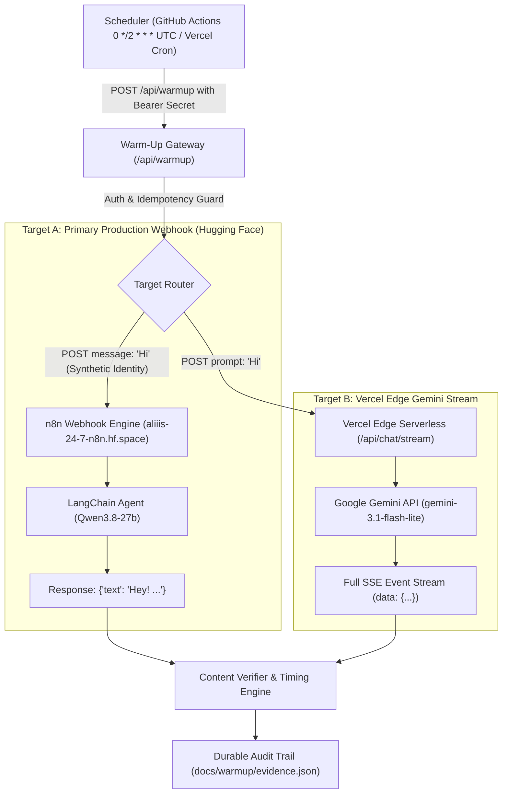

# Xare AI: Automated 2-Hour Chat Warm-Up Subsystem

## 1. Executive Summary

The **Xare AI 2-Hour Chat Warm-Up Subsystem** eliminates cold-start freezing, latency spikes, and request timeouts that occur when Xare AI has not received a user message for an extended duration.

When unvisited overnight or during idle hours:
1. **Hugging Face Spaces (`aliiis-24-7-n8n.hf.space`)**: Pauses or puts container resources into an idle state. Un-warmed first requests to the primary chat pipeline took **30s to 75s+**, occasionally triggering client abort timeouts (`N8N_REQUEST_TIMEOUT_MS = 75000`).
2. **Vercel Edge Functions (`/api/chat/stream`)**: Unloaded V8 worker instances, requiring cold DNS resolution and upstream SSL handshakes to Google Generative AI endpoints.
3. **Invalid Model Slug in `api/chat/stream.ts`**: The primary model slug was previously specified as `'Gemini 3.5 Flash Lite'` (with spaces), causing an initial failed upstream call and ~800–1500ms wasted delay before failing over to `'gemini-3.1-flash-lite'`.

The Warm-Up Subsystem dispatches an automated synthetic message (`Hi`) every **two hours** (`0 */2 * * * UTC`) through Xare's genuine production inference pipeline, verifying non-empty AI-generated completions while keeping both n8n and Edge workers primed.

---

## 2. Global Architecture & Pipeline Flow



---

## 3. Production Request Contract Compliance

The synthetic warm-up turn strictly adheres to the exact request contract used by [`src/App.tsx`](../../src/App.tsx):

### Primary n8n Webhook Payload
```json
{
  "taskId": "warmup_task_<runId>",
  "sessionId": "warmup_session_<runId>",
  "userId": "xare-warmup-synthetic-agent",
  "username": "Xare Warmup Agent",
  "message": "Hi",
  "chatInput": "Hi",
  "messageId": "msg_<runId>",
  "requestId": "req_<runId>",
  "action": "chat",
  "systemInstruction": "Role: You are Xare, a chill, smart, and highly capable multimodal AI assistant...",
  "timestamp": "2026-10-15T15:12:00.000Z"
}
```

### Isolation Guarantees
- **Synthetic Identity**: Uses `userId: 'xare-warmup-synthetic-agent'`. Messages are never written to real customer Firestore chats or exposed in user chat history.
- **Quota Safety**: Does not consume user quota counters or trigger external media processors (attachments, TTS audio, image generation, OCR).
- **Clean Stream Consumption**: In-memory consumers terminate immediately upon completion, leaving no hanging connections.

---

## 4. Scheduling & Cadence Configuration

### A. Recurring GitHub Actions Scheduler (`.github/workflows/warmup.yml`)
- **Cadence**: Every 2 hours (`0 */2 * * *`), firing at 00:00, 02:00, 04:00, 06:00, 08:00, 10:00, 12:00, 14:00, 16:00, 18:00, 20:00, 22:00 UTC.
- **Independence**: Runs completely in the cloud on GitHub Actions runners, independent of any open browser tab or client machine.
- **Concurrency Guard**: `group: xare-chat-warmup`, `cancel-in-progress: false` ensures zero duplicate overlapping runs.
- **Manual Trigger**: Supports `workflow_dispatch` with custom target selection (`all`, `n8n`, `edge`) and repeat count for benchmarking.

### B. Vercel Cron (`vercel.json`)
- **Plan Rule**: Vercel Hobby accounts are restricted to at most one cron job per day (`0 0 * * *`). To avoid build rejection on Hobby accounts, `vercel.json` is set to `0 0 * * *`. If upgraded to Vercel Pro, `schedule` can be updated to `0 */2 * * *`. GitHub Actions executes the full 2-hour cadence continuously.

---

## 5. Security & Authentication

Endpoints [`api/warmup/index.ts`](../../api/warmup/index.ts) and [`api/cron/warmup.ts`](../../api/cron/warmup.ts) enforce authentication:
- **Accepted Headers**:
  - `Authorization: Bearer <WARMUP_SECRET>`
  - `x-warmup-secret: <WARMUP_SECRET>`
  - `x-chatbot-token: <CHATBOT_TOKEN>`
- **Unauthorized Behavior**: Returns HTTP `401 Unauthorized` with zero upstream model dispatch.
- **Idempotency Protection**: 60-second cooldown gate prevents rapid request storms or denial-of-wallet loops.

---

## 6. Operational Commands & Verification

### Run the Warm-Up Suite Locally
```bash
# Execute full live warm-up against production
npm run warmup

# Run the automated unit & integration test suite
npm test
```

### Inspect Subsystem Health & Telemetry
```bash
# Query live health and recent run history
curl -H "x-chatbot-token: ali1234" https://xare-ai.vercel.app/api/warmup
```

---

## 7. Recovery & Emergency Disable Procedures

### How to Disable the Warm-Up Subsystem
1. **GitHub Actions**: Navigate to `Actions` -> `Xare AI 2-Hour Chat Warm-Up Subsystem` -> click `...` -> select `Disable workflow`.
2. **Environment Secret Revocation**: Remove or rotate `WARMUP_SECRET` in Vercel and GitHub Repository Settings.
3. **Vercel Cron**: Remove the `crons` block from `vercel.json` and deploy.

### Handling Upstream Provider Outages
- If Hugging Face Spaces reports container restart or maintenance, the warm-up runner logs the failure, backs off exponentially, and safely exits without creating request loops.
- Normal user chat will automatically offer or fall back to Gemini streaming mode as configured in `src/App.tsx`.
