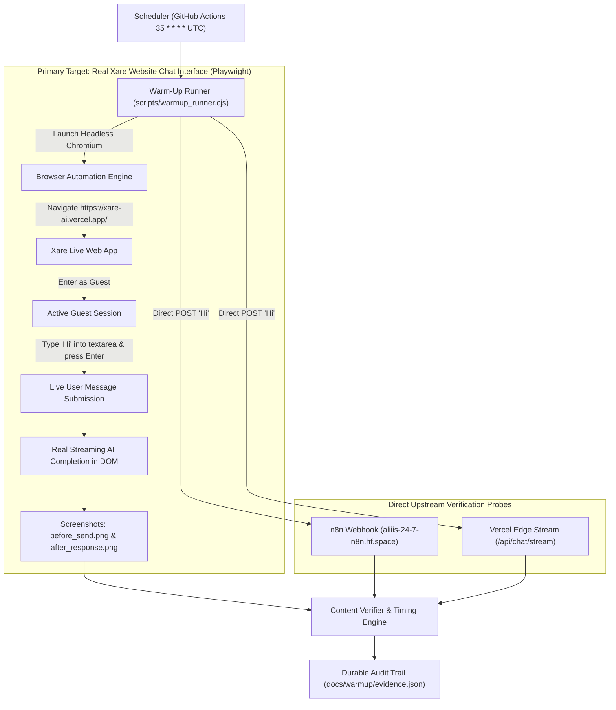

# Xare AI: Automated 1-Hour Chat Warm-Up Subsystem

## 1. Executive Summary

The **Xare AI 1-Hour Chat Warm-Up Subsystem** eliminates cold-start freezing, latency spikes, and request timeouts that occur when Xare AI has not received a user message for an extended duration.

When unvisited overnight or during idle hours:
1. **Live User Experience**: First-time website visitors would face cold-start delays if upstream containers had fallen asleep.
2. **Hugging Face Spaces (`aliiis-24-7-n8n.hf.space`)**: Pauses or puts container resources into an idle state. Un-warmed first requests to the primary chat pipeline took **30s to 75s+**, occasionally triggering client abort timeouts (`N8N_REQUEST_TIMEOUT_MS = 75000`).
3. **Vercel Edge Functions (`/api/chat/stream`)**: Unloaded V8 worker instances, requiring cold DNS resolution and upstream SSL handshakes to Google Generative AI endpoints.

The Warm-Up Subsystem dispatches an automated synthetic message (`Hi`) every **one hour** (`35 * * * * UTC`) through Xare's genuine website chat interface using headless browser automation (Playwright), verifying non-empty AI-generated completions in the real UI while keeping client-side pipelines, n8n, and Edge workers primed.

---

## 2. Global Architecture & Pipeline Flow



---

## 3. Production Request Contract Compliance

The synthetic warm-up turn operates through the real user-facing web interface and supports direct contract probes:

### Browser UI Interaction
- **URL**: `https://xare-ai.vercel.app/`
- **Session**: Supported guest mode (`localStorage.setItem('xare_active_session', 'guest')`)
- **Action**: Types `Hi` into the real input textarea, submits via Enter, and waits for the AI response to render in `.prose` / message bubbles.
- **Evidence**: Captures pre-submission (`docs/warmup/before_send.png`) and post-response (`docs/warmup/after_response.png`) screenshots.

### Primary n8n Webhook Payload
```json
{
  "taskId": "warmup_task_<runId>",
  "sessionId": "warmup_session_<runId>",
  "userId": "xare-warmup-synthetic-agent",
  "username": "Xare Warmup Agent",
  "message": "Hi",
  "chatInput": "Hi",
  "messageId": "msg_<runId>",
  "requestId": "req_<runId>",
  "action": "chat",
  "systemInstruction": "Role: You are Xare, a chill, smart, and highly capable multimodal AI assistant...",
  "timestamp": "2026-10-17T12:00:00.000Z"
}
```

### Isolation Guarantees
- **Synthetic Identity**: Uses guest session or `userId: 'xare-warmup-synthetic-agent'`. Messages do not collide with real registered customer Firestore accounts.
- **Quota Safety**: Does not consume external paid media quotas (TTS, image generation, OCR).
- **Clean Browser Lifecycle**: Browser contexts close immediately upon verification, leaving no orphan processes.

---

## 4. Scheduling & Cadence Configuration

### A. Recurring GitHub Actions Scheduler (`.github/workflows/warmup.yml`)
- **Cadence**: Every 1 hour continuously (`35 * * * *`), firing at 00:35, 01:35, 02:35, 03:35, ..., 23:35 UTC. Scheduled at minute 35 to avoid GitHub platform-level top-of-hour (:00) queue contention delays.
- **Independence**: Runs completely in the cloud on GitHub Actions runners, independent of any open browser tab or client machine.
- **Browser Automation in CI**: Headless Chromium is installed and executed in the runner (`npx playwright install --with-deps chromium`).
- **Concurrency Guard**: `group: xare-chat-warmup`, `cancel-in-progress: false` ensures zero duplicate overlapping runs.
- **Manual Trigger**: Supports `workflow_dispatch` with custom target selection (`browser`, `all`, `n8n`, `edge`) and repeat count for benchmarking.

### B. Scheduler Single Source of Truth
- **Dedicated Cloud Runner**: GitHub Actions executes the full 1-hour cadence continuously (`35 * * * * UTC`) without plan restrictions or charges.
- **Vercel Cron Removed**: The daily cron was removed from `vercel.json` to eliminate duplicate scheduler drift, eliminate confusion between daily vs 1-hour triggers, and avoid Vercel Hobby plan 1-cron/day restrictions. All scheduling is managed strictly via GitHub Actions.

---

## 5. Security & Authentication

Endpoints [`api/warmup/index.ts`](../../api/warmup/index.ts) and [`api/cron/warmup.ts`](../../api/cron/warmup.ts) enforce authentication:
- **Accepted Headers**:
  - `Authorization: Bearer <WARMUP_SECRET>`
  - `x-warmup-secret: <WARMUP_SECRET>`
  - `Authorization: Bearer <CRON_SECRET>`
- **Unauthorized Behavior**: Returns HTTP `401 Unauthorized` with zero upstream model dispatch. Fails closed if neither secret is configured on the server.
- **Idempotency Protection**: 60-second cooldown gate prevents rapid request storms or denial-of-wallet loops.

---

## 6. Operational Commands & Verification

### Run the Warm-Up Suite Locally
```bash
# Execute browser UI warm-up against production website
npm run warmup

# Run the comprehensive 11-test unit, security, and live browser integration suite
npm test
```

### Inspect Subsystem Health & Telemetry
```bash
# Query live health and recent run history
curl -H "Authorization: Bearer <WARMUP_SECRET>" https://xare-ai.vercel.app/api/warmup
```

---

## 7. Recovery & Emergency Disable Procedures

### How to Disable the Warm-Up Subsystem
1. **GitHub Actions**: Navigate to `Actions` -> `Xare AI 1-Hour Chat Warm-Up Subsystem` -> click `...` -> select `Disable workflow`.
2. **Environment Secret Revocation**: Remove or rotate `WARMUP_SECRET` in Vercel and GitHub Repository Settings.

### Handling Upstream Provider Outages
- If Hugging Face Spaces reports container restart or maintenance, the warm-up runner logs the failure, backs off exponentially, and safely exits without creating request loops.
- Normal user chat will automatically offer or fall back to Gemini streaming mode as configured in `src/App.tsx`.
